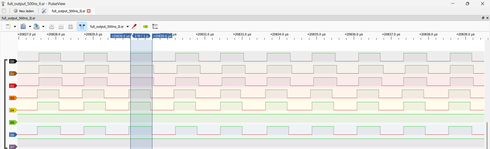

# Protodeck (`bitbanging` branch)

Software bit-banging verification for **Protodeck**. These tests check whether the perfboard pins and rails can handle signal toggling speeds required for SPI without relying on hardware peripherals, while isolating cold joints, crosstalk, or timing faults.

## Test Sequence (500 ns Target)

Run the bit-banging tests in order so each tested pin has unpulled neighboring pins around it before moving to full pin activity:

1. **Crisscross 1 (`crisscross_0.5mus_main.cpp`):** Toggles `CE I/II`, `MOSI I/II`, and `MISO I/II` high and low at a targeted 500 ns interval.
2. **Crisscross 2 (`crisscross_0.5mus_2_main.cpp`):** Toggles `CSN I/II`, `SCK I/II`, and `IRQ I/II` high and low at a targeted 500 ns interval.
3. **Full output (`full_output_0.5mus_main.cpp`):** Toggles every pin on Header I and Header II (except `3V3` and `GND`) high and low at a targeted 500 ns interval.

## Selecting a Test in `platformio.ini` & Flashing

You must update `platformio.ini` for each test you run:

1. Save your source file changes manually before building or flashing.
2. Open `platformio.ini` and remove the leading `;` on **only one** `build_src_filter` line for the active test, never leave multiple test lines uncommented at once:
   ```ini
   ;build_src_filter = -<*> +<bitbang_main/0.5mus_speedcycle/crisscross_0.5mus_main.cpp>
   build_src_filter = -<*> +<bitbang_main/0.5mus_speedcycle/crisscross_0.5mus_2_main.cpp>
   ;build_src_filter = -<*> +<bitbang_main/0.5mus_speedcycle/full_output_0.5mus_main.cpp>
3. Wire the debugger to the exposed 4 debugger pins and run commands from the CLI terminal rather than the VS Code bottom status bar:
  ```bash
pio run -t clean
pio run -t upload
```
  Running pio run -t clean first avoids flashing stale build artifacts from a previous test.  

#  Bench Verification Criteria
* **Oscilloscope check:** Measure each pin against GND (GND I or GND II). Non-pulled pins should stay at or below ~700–800 mV peak (higher amplitudes on non-pulled pins can cross logic-low thresholds and require rework), while pulled pins (excluding 3V3 and GND) target 3.3 V with ~500 ns timing (exponential/RC-like shapes are expected).


Showcase image of what a nonpulled pin should look like on the oscilloscope during crisscross tests

Showcase image of what a pulled pin should look like on the oscilloscope during crisscross tests and full output tests

* **Logic analyzer check (PulseView / fx2lafw):** Capture at 1M samples and 24 MHz (run Header I and Header II separately if an 8-channel analyzer is used). Measured rise-to-fall widths around 400–1000 ns are acceptable due to analyzer/software jitter, whereas values below 300 ns or above 1500 ns indicate hardware faults to fix before moving on.


Showcase image of a logic analyzer capture during a full output test

> *For a more visually detailed explanation/manual, see the **Hardware Bringup Manual** under the main branchs docs/documentation folder.*
