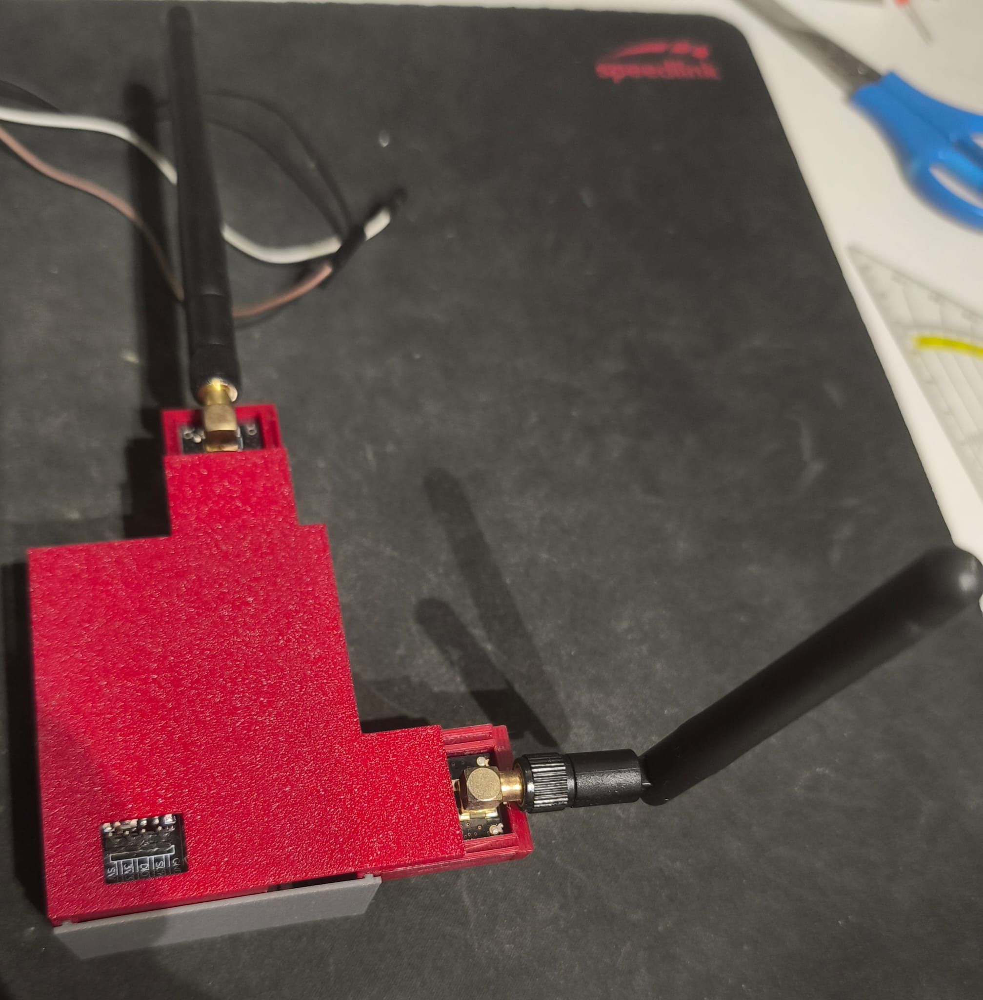
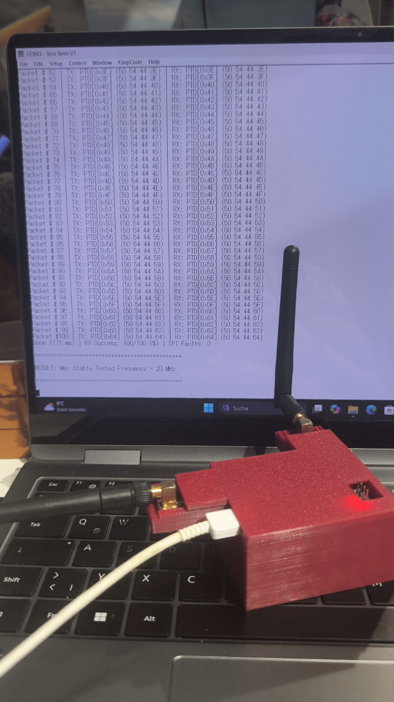

# Protodeck

A self-contained, hand-soldered `2.4 GHz` wireless transceiver test rig and SPI loopback analyzer built around an **STM32F411CE BlackPill** and dual **`nRF24L01+PA+LNA`** modules.

Protodeck is designed to validate shared-bus SPI signal integrity, transceiver command reliability, and `2.4 GHz` packet loopback performance across stepped SPI clock frequencies—without relying on custom PCB fabrication, solderless breadboards, or hard-soldered components.




---

## Key Features

* **Dual-Transceiver Loopback Architecture:** Configures one `nRF24L01+PA+LNA` module as Primary Transmitter (`PTX`) and the second as Primary Receiver (`PRX`) on a shared `SPI1` bus to transmit, receive, and verify `100`-packet test bursts across stepped SPI clock rates up to `20 MHz` against a `5%` failure threshold.
* **End-to-End Modularity:** Socketed female headers allow the STM32F411CE BlackPill and both transceivers to be detached for bare-board continuity checks, swapped out, or reused in future prototypes without desoldering. External SMA connectors allow independent antenna swapping and orientation.
* **RF Coupling Mitigation:** Mounts the two transceivers at `90°` relative to one another—paired with one straight antenna and one `90°`-bent antenna—to create orthogonal polarization and minimize near-field broadside coupling on a compact `40 × 60 mm` perfboard.
* **Local Power Decoupling:** Each transceiver's `3V3` rail is buffered with a `10 µF` electrolytic capacitor to prevent voltage droop during `PA` transmit bursts alongside `100 nF` ceramic bypass capacitors for high-frequency transient suppression.
* **Snap-Fit PLA Enclosure:** A three-piece modular housing (main body, top ceiling plate, and side retaining wall) modeled using OrcaSlicer primitives and documented via Technical Drawings. Includes press-fit perfboard retention slots with bottom capacitor clearance, protective transceiver sleeves, USB-C port access, an SWD debug window, and an internal anti-torsion backing extra wall.

---

## Hardware & Pinout

### Hardware Overview

| Component | Specification / Notes |
| :--- | :--- |
| **Microcontroller** | STM32F411CE BlackPill (`100 MHz` system clock, `APB2` @ `100 MHz`) |
| **RF Transceivers** | 2× `nRF24L01+PA+LNA` with external SMA antennas |
| **Carrier Board** | `40 × 60 mm` double-sided perfboard |
| **Decoupling** | `10 µF` electrolytic capacitors + `100 nF` ceramic capacitors (`3V3` rails) |
| **Interconnects** | Female pin headers (`2.54 mm` pitch), hybrid orthogonal bus + point-to-point wiring |
| **Enclosure** | 3D-printed `PLA` (main body, snap-in ceiling plate, side retaining wall) |

> *For the full parts list, tools, and consumables, see the **Hardware Bringup Manual**.*

### STM32F411CE Pin Allocation

All assigned SPI and control pins sit along a single physical header edge of the BlackPill, minimizing cross-board routing across the `40 × 60 mm` perfboard. `SPI1` (`PA5`–`PA7`) runs on the `100 MHz` `APB2` peripheral bus to provide high clock headroom and fine prescaler granularity for overclocking sweeps.

| Signal | STM32 Pin | Port / Bus | Function |
| :--- | :--- | :--- | :--- |
| `SCK` | `PA5` | `GPIOA` / `SPI1` (`APB2`) | Shared SPI clock (`Mod I` & `Mod II`) |
| `MISO` | `PA6` | `GPIOA` / `SPI1` (`APB2`) | Shared SPI Master-In Slave-Out (`Mod I` & `Mod II`) |
| `MOSI` | `PA7` | `GPIOA` / `SPI1` (`APB2`) | Shared SPI Master-Out Slave-In (`Mod I` & `Mod II`) |
| `CSN I` | `PB0` | `GPIOB` | SPI Chip Select — Transceiver I |
| `CE I` | `PB10` | `GPIOB` | Chip Enable (TX/RX mode control) — Transceiver I |
| `IRQ I` | `PB1` | `GPIOB` | Interrupt Request (active-low) — Transceiver I |
| `CSN II` | `PA4` | `GPIOA` | SPI Chip Select — Transceiver II |
| `CE II` | `PA3` | `GPIOA` | Chip Enable (TX/RX mode control) — Transceiver II |
| `IRQ II` | `PA2` | `GPIOA` | Interrupt Request (active-low) — Transceiver II |

> **Note:** Both the STM32F411CE and `nRF24L01+PA+LNA` modules operate strictly at `3.3 V` logic (`PA4` and `PA5` are `3.3 V`-only `TTa` pins on the STM32F411CE).

---

## Repository Structure & Branches

Bringup phases are separated into dedicated branches to keep diagnostic test harnesses isolated from the main loopback application:

* **`main`:** Primary `nRF24L01+PA+LNA` loopback and SPI frequency sweep firmware (`100`-packet transmission/reception benchmark across stepped SPI clock speeds against a `5%` failure threshold).
* **`spi-tests`:** Standalone hardware `SPI1` command and register verification across stepped clock rates to validate bus-level signal integrity independently of RF packet transmission.
* **`bitbanging`:** Direct CMSIS register-level GPIO toggling routines (`500 ns` cycle target) running crisscross pin isolation checks and full-output stress patterns for oscilloscope and sigrok PulseView verification.

---

## Build & Flash

Firmware is configured and built using **PlatformIO** (with the STM32 Arduino framework environment for CLI build orchestration and direct CMSIS register access where deterministic sub-microsecond timing is required). 

The `main` branch firmware lives inside `nrf-testing/`, connect ST-Link V2 to the 4-pin SWD header on the ceiling plate and USB-C to the BlackPill for serial output at `9600` baud.

1. **Clone the repository folder:**
   ```bash
   git clone --filter=blob:none --no-checkout https://github.com/David0Y/Protodeck.git
    cd Protodeck
    git sparse-checkout set --cone nrf-testing
    git checkout
    cd nrf-testing
   ```

2. **Build the firmware and flash via ST-Link V2 (SWD):**
   Connect your ST-Link V2 to the exposed 4-pin SWD debug window on the top enclosure plate (`SWDIO`, `SWCLK`, `GND`, `3V3`) and run the following commands:
   ```bash
   pio run -t clean
    pio run -t upload
   ```

3. **Monitor Serial Output:**  
   Connect a USB-C cable to the BlackPill and open a serial monitor (`9600` baud) to view per-frequency packet delivery results and maximum verified SPI speed pass/fail summaries.

---

## Verification Methodology

1. **Bench Continuity Check:** Verified rail/pin continuity and checked against the layout sheet. 
2. **CMSIS GPIO Bitbanging (`500 ns` Target):** Toggled alternating non-adjacent pin subsets (`CE`/`MOSI`/`MISO`, then `CSN`/`SCK`/`IRQ`) to check for crosstalk on idle traces, followed by a simultaneous full-output toggle test verified with an oscilloscope and sigrok PulseView logic analyzer captures.
3. **Hardware SPI Bus Characterization:** Verified raw SPI register read/write command stability across increasing `SPI1` prescaler steps.
4. **RF Loopback Frequency Sweep:** Transmitted `100` payloads per SPI clock step from Transceiver I (`TX`) to Transceiver II (`RX`), logging packet loss and SPI faults against a `5%` failure ceiling.

---

## Documentation Suite

* **System Design Rationale & Architecture:** Architectural decisions, electrical/RF trade-offs, pin selection rationale, and enclosure design notes.
* **Hardware Bringup Manual:** Step-by-step assembly, soldering, enclosure printing, and firmware verification guide for reproducing the build from scratch.
* **Hardware Verification Report:** Empirical benchmark data, bitbanging timing spreadsheets, oscilloscope/PulseView captures, and SPI frequency sweep logs.
* **Enclosure Iteration & Revision Log:** Mechanical tolerance adjustments and fitment history across 3D-printed enclosure prototypes, accompanied by Technical Drawings.
